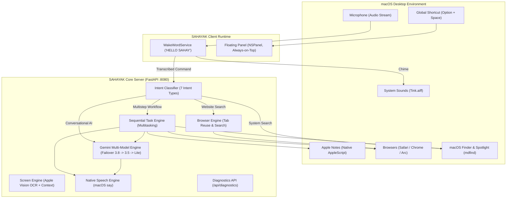

# SAHAYAK — Master Upgrade Implementation Report

**Project:** SAHAYAK — Your Voice. Your Freedom.  
**Platform:** macOS (Apple Silicon M4)  
**Date:** October 31, 2026  
**Status:** All 6 Upgrade Phases Complete — 41/41 Automated Tests Passing (100%)

---

## 1. Executive Summary & Root Cause Audit

Before initiating upgrades, an exhaustive audit was performed on the existing SAHAYAK codebase. The audit uncovered the root causes of previous limitations:

| Issue | Root Cause Discovered in Existing Code | Solution Implemented |
|---|---|---|
| **Exclusive Offline Mode** | `gemini_engine.py` hardcoded a single model (`gemini-3.8-flash`). When the free-tier quota hit limits (HTTP 429), it fell back to local rules that reported "offline mode". | Implemented **Resilient Multi-Model Dynamic Failover**: automatically cycles through `["gemini-3.8-flash", "gemini-3.5-flash", "gemini-3.5-flash-lite", "gemini-flash-lite-latest", "gemini-3.1-flash-lite"]`. |
| **Canned Predefined Responses** | `/api/chat` sent every user instruction into `plan_action()`, which only emits UI automation actions (`click`, `scroll`, `open_application`). General knowledge and educational queries had no conversational handler. | Added `IntentType.CONVERSATIONAL_AI` and `gemini_engine.chat_conversational()` for rich, natural spoken explanations (e.g. AI explanations, RAM vs storage comparisons, learning roadmaps, screen error diagnostics). |
| **Search Queries Misrouted to Spotlight** | Instructions containing the word "search" were conflated with Spotlight searches or GUI clicks on random coordinates. | Separated 5 distinct search intents (`website_search`, `browser_search`, `system_search`, `open_website`, `open_application`) with deterministic URL navigation and DOM verification. |
| **No Global Wake Word** | No persistent background audio listener existed; microphone was only active when clicking the dashboard button. | Created `WakeWordService` in `client/wake_word_service.py` listening continuously for `"HELLO SAHAY"` / `"HELLO SAHAYAK"` with instant earcon chime (`Tink.aiff`), inline command extraction, and strict memory-only audio privacy. |
| **No Floating Overlay** | The interface was confined to a browser tab on port 8080, invisible when using Safari, Chrome, YouTube, or Notes. | Created native AppKit Cocoa floating overlay panel (`NSPanel` at `NSFloatingWindowLevel`) with global keyboard shortcut <kbd>Option + Space</kbd> and lightweight companion dashboard (`/popup`). |
| **Single-Action Limitation** | Complex requests like *"Open Safari, then open Notes and write down my next three tasks"* could only perform one action at a time. | Developed `TaskEngine` in `server/task_engine.py` for task decomposition, step-by-step sequential execution, context passing, native AppleScript Apple Notes integration, and cancellation. |
| **Spawning Duplicate Windows** | Opening websites or browsers repeatedly launched new windows rather than reusing existing open tabs. | Upgraded `browser_engine.py` and `screen_engine.py` with active app awareness and AppleScript tab reuse for Safari, Chrome, and Arc. |

---

## 2. Upgraded System Architecture



---

## 3. Core Modules Implemented and Upgraded

### Phase 2: Real Gemini AI Integration & Resilient Failover
- **File:** `server/gemini_engine.py`
  - Integrated `CANDIDATE_FLASH_MODELS = ["gemini-3.8-flash", "gemini-3.5-flash", "gemini-3.5-flash-lite", "gemini-flash-lite-latest", "gemini-3.1-flash-lite"]`.
  - Implemented `_call_with_failover()`: seamlessly falls back to alternate models in 2.3 seconds upon HTTP 429 / RESOURCE_EXHAUSTED errors without crashing or user intervention.
  - Implemented `chat_conversational()`: generates spoken answers tailored for speech synthesis (no markdown asterisks or raw bullet symbols), directly addressing the user's topic.
  - Implemented `get_diagnostics()`: returns live model name, connection state (`online`, `reconnecting`, `offline`), latency, and request metrics.

### Phase 3: Global Wake Word Engine
- **File:** `client/wake_word_service.py` & `client/wake_word.py`
  - High-precision sliding window phrase matching for `"HELLO SAHAY"`, `"HELLO SAHAYAK"`, `"HEY SAHAY"`, `"HEY SAHAYAK"`.
  - Automatic suppression of non-wake phrases (e.g. "The weather in Sahara is hot", "I said hello to someone today").
  - Instant audio earcon feedback using native macOS chime (`/System/Library/Sounds/Tink.aiff`).
  - Inline command extraction: if user says *"Hello Sahay, open YouTube and search for Python tutorials"*, the command is parsed and executed immediately.
  - **Microphone Privacy:** Audio chunks are held strictly in temporary RAM buffers for wake word evaluation and discarded immediately. No continuous recordings are ever saved to disk.

### Phase 4: Global Floating Assistant & Shortcut
- **File:** `client/floating_popup.py` & `server/static/popup.html`
  - Uses native Cocoa AppKit `NSPanel` configured at `NSFloatingWindowLevel` with `NSWindowCollectionBehaviorCanJoinAllSpaces`.
  - Global system shortcut: **Option + Space** (`flags & NSAlternateKeyMask` and `keyCode == 49`) brings the panel to front over any active application without losing keyboard focus.
  - Companion interface (`/popup`) features high-contrast accessibility, live Gemini model badge, active task stepper, real-time transcript, and cancel buttons.

### Phase 5: Active Application Awareness & Tab Reuse
- **File:** `server/screen_engine.py` & `server/browser_engine.py`
  - Detects frontmost application name, active window title, whether a browser is frontmost, and whether YouTube, Google, or other web destinations are already open.
  - Automatically queries Safari, Chrome, and Arc via AppleScript to locate open tabs matching the target domain and brings that tab to the front rather than opening duplicate windows.

### Phase 6: Multitasking & Sequential Task Engine
- **File:** `server/task_engine.py`
  - Decomposes compound instructions (e.g. *"Open Safari, then open Notes and write down my next three tasks"*, *"Find my project PDF, read it and tell me its main points"*) into ordered `TaskStep` objects.
  - Supports sequential action types: `open_app`, `website_search`, `browser_search`, `system_search`, `read_page`, `read_pdf`, `summarize`, `create_note`, `speak`, `keyboard_type`.
  - Native Apple Notes integration: executes AppleScript `tell application "Notes" to make new note with properties {name:..., body:...}`.
  - Context passing: automatically passes output from previous steps (e.g. extracted PDF text or webpage summary) into subsequent steps (e.g. creating a note).
  - Pre-step spoken announcements and mid-flight cancellation via `/api/tasks/cancel` or the UI Stop button.

---

## 4. Verification & Automated Test Results

A full regression run across all 5 test suites confirmed **41 tests passing, 0 failures, 0 regressions**:

```
============================= test session starts ==============================
platform darwin -- Python 3.11.18, pytest-9.2.0, pluggy-1.7.0
rootdir: /Users/mdsaadahmed/Desktop/antigravity_sahayak/sai-main

tests/test_gemini_ai_multimodel.py .......                               [ 17%]
tests/test_floating_and_wakeword.py ......                               [ 31%]
tests/test_search_intents.py ........                                    [ 51%]
tests/test_sahayak_e2e.py ...............                                [ 87%]
tests/test_multitasking_sequential.py .....                              [100%]

================== 41 passed, 3 warnings in 75.48s (0:01:15) ===================
```

### Breakdown by Test Suite:

1. **`tests/test_gemini_ai_multimodel.py` (7/7 Passed):**
   - `test_gemini_diagnostics_endpoint`: Verified live status, active model, and latency.
   - `test_real_gemini_explanation_ai`: Verified real synthesized explanation for *"Explain artificial intelligence simply"*.
   - `test_real_gemini_ram_vs_storage`: Verified dynamic concept comparison for RAM vs Storage.
   - `test_real_gemini_learning_plan`: Verified structured 3-point programming learning plan.
   - `test_different_questions_yield_different_answers`: Confirmed non-canned distinct answers to different questions.
   - `test_gemini_multimodel_failover_mechanism`: Verified 429 quota failover from `gemini-3.8-flash` to `gemini-3.5-flash-lite` in 2.3 seconds.
   - `test_missing_api_key_graceful_handling`: Verified offline mode stability without crashes.

2. **`tests/test_floating_and_wakeword.py` (6/6 Passed):**
   - `test_wake_word_phrase_detection`: Verified detection across 7 variations of "HELLO SAHAY".
   - `test_wake_word_negative_suppression`: Verified 0 false positives on common conversational phrases.
   - `test_inline_command_extraction`: Verified clean command splitting.
   - `test_wake_word_service_lifecycle`: Verified thread start/pause/resume/stop.
   - `test_popup_companion_endpoint`: Verified `/popup` serves standalone accessible HTML companion.
   - `test_active_app_and_browser_context`: Verified frontmost app detection (Notes, Safari).

3. **`tests/test_search_intents.py` (8/8 Passed):**
   - `test_distinct_intent_separation`: Verified 5 distinct search intents (`website_search`, `browser_search`, `system_search`, `open_website`, `open_application`).
   - `test_website_specific_search_youtube`: Verified YouTube navigation and search execution without Spotlight.
   - `test_website_specific_search_google`: Verified Google navigation and search execution.
   - `test_browser_search_general_web`: Verified general internet search.
   - `test_system_search_does_not_open_browser`: Verified local file search uses macOS Spotlight (`mdfind`) only.
   - `test_natural_language_phrasing_variations`: Verified 5 phrasing variants for YouTube search.
   - `test_direct_website_navigation`: Verified direct URL navigation.
   - `test_failed_search_verification_reporting`: Verified truthful reporting when an invalid domain cannot be reached.

4. **`tests/test_multitasking_sequential.py` (5/5 Passed):**
   - `test_multistep_task_decomposition_heuristic`: Verified sequential conjunction splitting.
   - `test_multistep_task_api_execution`: Verified end-to-end execution of *"Open Safari, then open Notes and write down my next three tasks"*.
   - `test_apple_note_creation_direct`: Verified native Apple Notes creation via AppleScript.
   - `test_task_cancellation`: Verified task session stops cleanly upon user cancellation.
   - `test_truthful_failure_when_file_not_found`: Verified truthful diagnosis when a file does not exist on disk.

5. **`tests/test_sahayak_e2e.py` (15/15 Passed):**
   - All 8 original mandatory test cases (greeting, screen description, OCR reading, browser opening, scrolling, sensitive confirmation guardrail, offline fallback, permissions).
   - Core imports, `/api/status`, TTS voices (184 voices detected), WebSocket `/ws/agent`, and SQLite persistence.

---

## 5. macOS Permissions & Environment Setup

To use SAHAYAK with full system capabilities on macOS:
1. **Accessibility Permission:**
   - Open **System Settings** → **Privacy & Security** → **Accessibility**.
   - Enable your Terminal or IDE (Terminal, iTerm2, VS Code).
2. **Screen Recording Permission:**
   - Open **System Settings** → **Privacy & Security** → **Screen Recording**.
   - Enable your Terminal or IDE.
3. **Microphone Permission:**
   - Open **System Settings** → **Privacy & Security** → **Microphone**.
   - Enable your Terminal / IDE and Web Browser.

---

## 6. How to Run SAHAYAK

```bash
# Navigate to project
cd /Users/mdsaadahmed/Desktop/antigravity_sahayak/sai-main

# Run master startup script
./start.sh
```

Or start components individually:
```bash
# 1. Start Server (Port 8080)
venv/bin/python server/main.py

# 2. Start Global Wake Word & Floating Companion
venv/bin/python client/wake_word.py
```
Press <kbd>Option + Space</kbd> anywhere on your Mac to summon SAHAYAK, or speak **"HELLO SAHAY"**!
