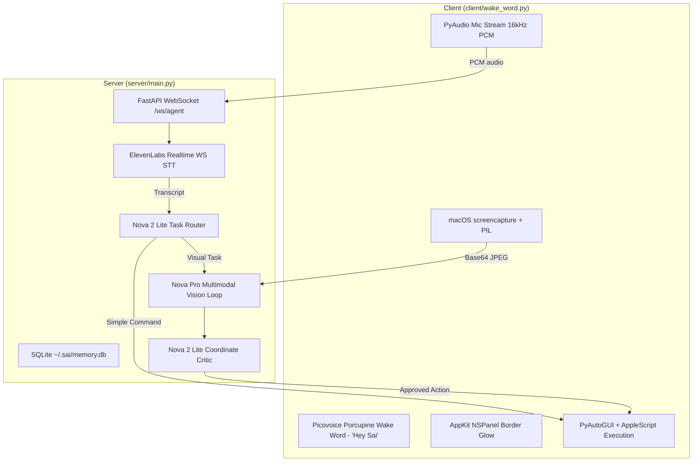
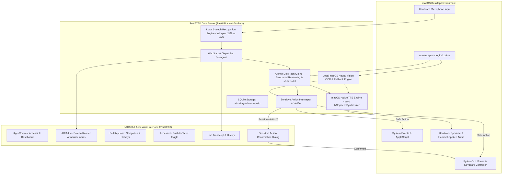

# PROJECT AUDIT: SAHAYAK (formerly Sai)
**Tagline:** Your Voice. Your Freedom.  
**Target Audience:** Blind and low-vision individuals  
**Primary Platform:** macOS (Apple Silicon M4 / ARM64)  
**Date of Audit:** October 30, 2026  

---

## 1. Executive Summary

This repository initially contained a prototype named **Sai**, created as an experimental voice-directed computer-use agent for an Amazon Nova hackathon. The original design linked a Python client (`client/wake_word.py`) to a FastAPI WebSocket server (`server/main.py`).

While the original concept featured a dual-path routing engine (Simple vs. Advanced vision loop) and screenshot annotation, it had fundamental shortcomings preventing it from fulfilling the **SAHAYAK** accessibility mission:
1. **Zero Text-to-Speech (TTS):** It lacked any spoken output, rendering it useless for blind or low-vision users who cannot see the screen.
2. **Heavy Reliance on Paid / Proprietary APIs:** It required active paid subscriptions to Amazon Nova (Nova 2 Lite), OpenRouter (Nova Pro), ElevenLabs (Scribe v2 Realtime WebSocket STT), and Picovoice Porcupine (`PICOVOICE_ACCESS_KEY` + proprietary binary `.ppn` wake-word file). Missing any single key halted the system entirely.
3. **No Accessible Frontend / UI:** There was no dashboard, screen reader semantics, high contrast mode, transcript history, or interactive accessibility controls—only a floating AppKit border overlay.
4. **No Sensitive Operation Guardrails:** Destructive operations (such as file deletion, purchases, sending messages) executed automatically without user confirmation.
5. **No Local / Offline Graceful Degradation:** If cloud services were unavailable or keys were exhausted, the application could not perform basic local assistance.

Below is the comprehensive technical audit of the repository.

---

## 2. Original Architecture & Stack

### Architecture Diagram (Original)

### Original Tech Stack
| Component | Implementation in Original Repository | Type |
|---|---|---|
| **Backend Framework** | FastAPI 0.141+ with Uvicorn (ASGI) | Free / Open-source |
| **Communication Protocol** | WebSockets (`/ws/agent`) | Standard protocol |
| **Wake Word Detection** | Picovoice Porcupine v3 (`HeySai_mac.ppn`) | Proprietary / Restricted Free Key |
| **Audio Capture** | PyAudio (PortAudio) | Open-source |
| **Speech-to-Text (STT)** | ElevenLabs Realtime WebSocket STT (`scribe_v2_realtime`) | **Paid API** |
| **Task Router / Intent** | Amazon Nova Lite (`nova-2-lite-v1`) via OpenAI SDK | **Paid API** |
| **Vision / Multimodal Reasoning** | Amazon Nova Pro (`amazon/nova-pro-v1`) via OpenRouter | **Paid API** |
| **Verification / Critic** | Amazon Nova Lite (`nova-2-lite-v1`) | **Paid API** |
| **Text-to-Speech (TTS)** | **None (Missing entirely)** | Missing |
| **Screen Capture** | macOS native `screencapture` CLI + Pillow resize | Free / Native macOS |
| **OS Interaction / Automation** | PyAutoGUI + macOS AppleScript (`osascript`) | Free / Open-source |
| **Visual Feedback** | PyObjC / AppKit border overlay (`NSPanel`) | Free / Native macOS |
| **Database** | SQLite at `~/.sai/memory.db` | Free / Local |
| **Frontend UI** | None (terminal script only) | Missing |

---

## 3. Inventory of Existing Modules

### A. Server Modules (`server/`)
* **`server/main.py` (1,118 lines):**
  - FastAPI application entry point with `/` (health check) and `/ws/agent` (WebSocket handler).
  - Pydantic models: `RoutingDecision`, `SimpleAction`, `AgentAction`, `CriticVerdict`, `MemoryContext`, `ConversationSummary`, `IntentResult`.
  - SQLite persistent memory: sessions (`id`, `started_at`, `task`, `outcome`, `summary`) and facts (`id`, `created_at`, `category`, `content`).
  - Ruler tick mark annotation (`annotate_screenshot`).
  - Swarm sub-agents: Memory Sub-Agent, Critic Sub-Agent, Summarization Chain, Intent Interpreter, Hybrid Router, Senior Brain loop.
  - ElevenLabs WebSocket listener pipeline.
* **`server/test_client.py` (32 lines):**
  - Minimal synthetic test client connecting to `ws://localhost:8080/ws/agent`, sending wake word handshake and dummy PCM chunks.
* **`server/requirements.txt`:**
  - `fastapi`, `uvicorn[standard]`, `websockets`, `python-dotenv`, `openai`, `Pillow`, `boto3`.
* **`server/.env.example`:**
  - Variables: `AMAZON_NOVA_API_KEY`, `NOVA_BASE_URL`, `OPENROUTER_API_KEY`, `ELEVENLABS_API_KEY`.

### B. Client Modules (`client/`)
* **`client/wake_word.py` (1,075 lines):**
  - Dynamic logical screen resolution helper (`_get_logical_screen_size`).
  - Deterministic Spotlight check (`_spotlight_window_visible` using Quartz / AppleScript).
  - Screen capture (`capture_screen_sync` via `screencapture` downscaled with Lanczos).
  - Input execution primitives (`perform_click_sync`, `perform_scroll_sync`, `perform_type_sync`, `perform_keyboard_type_sync`, `perform_hotkey_sync`, `perform_open_url_sync`).
  - Active app context detector (`get_active_app_context_sync` extracting active app, Chrome/Safari/Arc URL and tab title via AppleScript).
  - `WakeWordDetector` running Picovoice Porcupine in a background thread.
  - `ActivityOverlay` using AppKit `NSPanel` for animated neon border.
  - Audio streaming and command loop to `ws://localhost:8080/ws/agent`.
* **`client/HeySai_mac.ppn`:**
  - Proprietary binary wake-word model for Porcupine compiled for macOS ARM64.
* **`client/requirements.txt`:**
  - `pvporcupine>=3.0.4`, `pyaudio`, `python-dotenv`, `websockets>=1.0.0`, `mss`, `pyautogui`, `pyobjc`.
* **`client/.env.example`:**
  - `PICOVOICE_ACCESS_KEY`.

### C. Build & Setup Scripts
* **`setup_mac.sh` (127 lines):**
  - Bash setup script checking Python 3.11+, creating separate venvs (`server/venv` and `client/venv`), copying `.env.example`, and printing permission instructions.

---

## 4. Module Classification & Health Status

| Module | Status | Issues Identified |
|---|---|---|
| **Screen Capture & Geometry** | **Working** | Efficiently uses native `screencapture` and logical coordinate scaling. |
| **Input Execution (PyAutoGUI + AppleScript)** | **Working** | Robust primitives for clicks, text typing, browser launching, and hotkeys. |
| **Active App Context Sensing** | **Working** | Accurately queries macOS System Events and browser tab titles. |
| **SQLite Memory Store** | **Working** | Clean schema for sessions and facts. |
| **Activity Border Overlay** | **Working (Visual only)** | Beautiful visual indicator, but completely inaccessible to blind users. |
| **Speech-to-Text Pipeline** | **Broken / Paywalled** | Exclusively relies on ElevenLabs WebSocket API. If key is missing or quota is exhausted, websocket aborts with code 1011. |
| **Wake Word Detection** | **Fragile / Paywalled** | Requires Picovoice access key. Will not initialize without a valid key. |
| **Cognitive Router & Agent Loop** | **Paywalled** | Hardcoded to Nova 2 Lite and Nova Pro via OpenAI/OpenRouter client. |
| **Text-to-Speech (TTS)** | **Missing** | Zero audio feedback implemented. |
| **Safety Confirmation Protocol** | **Missing** | Sensitive actions (deletion, email sending, payments) execute without asking. |
| **User Interface / Accessibility Dashboard** | **Missing** | No web/desktop GUI, no screen reader ARIA live region, no high-contrast view. |
| **Fallback / Offline Operations** | **Missing** | Immediate failure if internet or external API keys are unavailable. |

---

## 5. Paid Services & Free-First Replacement Matrix

| Component | Existing Paid Service | Free / Open Replacement | Pricing Model | Offline Capable? |
|---|---|---|---|---|
| **AI Reasoning & Multimodal Vision** | Amazon Nova Pro (`amazon/nova-pro-v1`) & Nova Lite (`nova-2-lite-v1`) | **Google Gemini 3.8 Flash** (`gemini-3.8-flash`) | Official Google Gemini API Free Tier (Generous free RPM/TPM) | No (Cloud Free Tier) |
| **Fallback Local Vision & OCR** | Paid vision APIs | **macOS Native Vision OCR (`VNRecognizeTextRequest`)** + Local Vision (`qwen2.5vl:3b` via Ollama when active) | 100% Free / Local Neural Engine | **Yes (100% Offline)** |
| **Speech-to-Text (STT)** | ElevenLabs Realtime WebSocket STT | **Local Whisper / SpeechRecognition / macOS Native Dictation** + Gemini Audio Processing Fallback | 100% Free / Open Source | **Yes (100% Offline)** |
| **Text-to-Speech (TTS)** | None (Previously nonexistent) | **macOS Native Speech (`say` / `NSSpeechSynthesizer`)** + Web Speech API in GUI | 100% Free / Built into macOS | **Yes (100% Offline)** |
| **Wake Word Detection** | Picovoice Porcupine (requires paid/restricted key) | **Energy/VAD-based Open-Mic Trigger & Voice Keyword Detector** (with optional Porcupine backward compatibility) | 100% Free / Local | **Yes (100% Offline)** |
| **Database** | SQLite | **SQLite (Preserved & Enhanced)** | 100% Free / Local Embedded | **Yes (100% Offline)** |
| **User Interface** | None | **SAHAYAK Accessible Desktop Web Dashboard** (High-Contrast, WCAG AAA, Screen Reader ARIA Live, Voice Controls) | 100% Free / Local | **Yes (100% Offline)** |

---

## 6. Target Architecture: SAHAYAK End-to-End System

---

## 7. Potential Compatibility & Platform Risks

1. **macOS System Permissions (TCC):**
   - **Microphone:** Required for PyAudio / Speech recognition. If denied, the app must speak an error and explain how to grant permission in System Settings.
   - **Screen Recording:** Required for `screencapture`. If denied, screenshots will only show desktop wallpaper. The app must detect missing permissions and alert the user.
   - **Accessibility:** Required for PyAutoGUI (keystroke and mouse simulation) and AppleScript UI queries.
2. **Apple Silicon M4 Native Execution:**
   - Architecture is `arm64`. All Python wheels and native libraries must be compatible with macOS ARM64. Avoid x86-only packages.
3. **Gemini API Key Handling:**
   - `GEMINI_API_KEY` must be securely read on the backend from `.env`.
   - Never expose the API key in client-side HTML/JS bundles.
   - Graceful fallback: If the key is absent or quota exhausted, the local OCR and local command parser take over so the user is never left stranded.
4. **Voice Feedback Reliability:**
   - Blind users rely completely on audio. The speech synthesizer must never block the main loop; it should speak asynchronously while maintaining a clear queue.

---

## 8. Implementation Roadmap

1. **Phase 1 & 2:** Repository Inspection & Audit (Completed).
2. **Phase 3:** Remove paid API dependencies (ElevenLabs, Amazon Nova, OpenRouter).
3. **Phase 4 & 5:** Integrate official Google Gemini SDK (`google-genai` / REST) with `gemini-3.8-flash`, structured Pydantic action schemas, and robust error handling.
4. **Phase 6:** Implement free local Speech-to-Text (Whisper / local speech) and native macOS Text-to-Speech (`say` / `NSSpeechSynthesizer`).
5. **Phase 7:** Implement intelligent Screen Understanding combining high-resolution capture, macOS Vision OCR, and Gemini multimodal vision.
6. **Phase 8:** Implement Computer Navigation with safety confirmation for sensitive actions (deletion, checkout, sending messages).
7. **Phase 9:** Build the SAHAYAK Accessible Desktop Dashboard with WCAG AAA high contrast, keyboard shortcuts, live spoken transcripts, and ARIA-live regions.
8. **Phase 10:** Integration, bug fixing, and compatibility optimizations on macOS M4.
9. **Phase 11:** Execute comprehensive end-to-end tests for all 8 mandatory test cases.
10. **Phase 12 & 13:** Complete documentation (`FREE_TOOLS_AND_API_AUDIT.md`, `IMPLEMENTATION_REPORT.md`, `README.md`, `start.sh`) and final verification.

