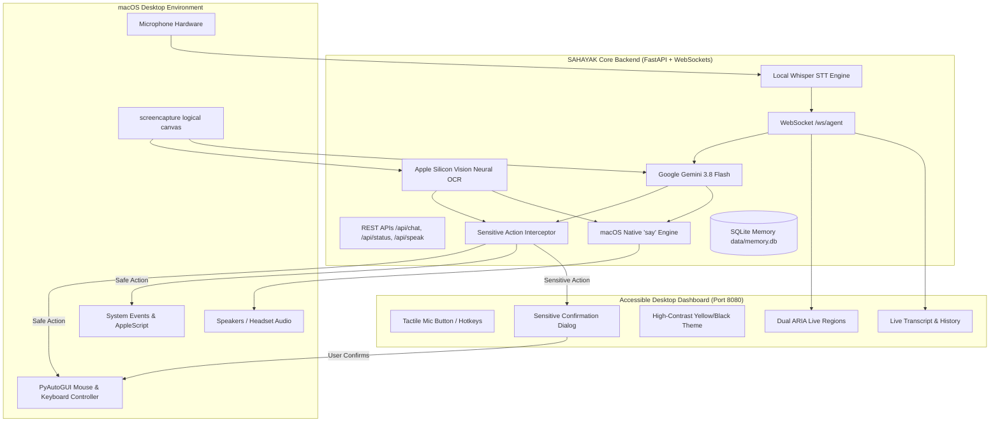

# SAHAYAK

**Your Voice. Your Freedom.**

A voice-first, AI-powered computer accessibility assistant designed primarily for blind and low-vision individuals.

SAHAYAK enables users to interact with their computers independently through natural voice commands. It sees what is displayed on screen, speaks information aloud, navigates supported applications, executes computer operations, and requires explicit user confirmation before any sensitive or irreversible actions.

---

## 1. Project Objectives

- **Independence:** Enable visually impaired users to use macOS computers without requiring visual assistance.
- **Voice-First Experience:** Full voice interaction pipeline (Global Wake Word "HELLO SAHAY" → Voice Input → Local STT → Multi-model Gemini Reasoning → Action Execution → Spoken Feedback).
- **Free-First Engineering:** 100% free of paid APIs and subscriptions. Employs Google Gemini Flash free tier with automatic multi-model failover (`gemini-3.8-flash` → `gemini-3.5-flash` → `gemini-3.5-flash-lite`), on-device macOS Neural Vision OCR, and native speech synthesis.
- **Floating Overlay Companion:** Always-on-top accessible floating popup accessible anywhere across macOS with global hotkey <kbd>Option+Space</kbd>.
- **Multitasking & Sequential Actions:** Decomposes complex multi-step instructions into verified sequential steps (e.g., search, summarize, and save directly to Apple Notes).
- **Active App Awareness & Tab Reuse:** Automatically detects frontmost applications and browser tabs (YouTube, Google, Safari, Chrome), reusing existing tabs rather than spawning duplicate windows.
- **Safety by Design:** Irreversible actions (file deletion, checkout, sending emails) require explicit user confirmation before execution.
- **Resilient Fallback:** Seamlessly operates in Local Offline Assistive Mode if the internet or external AI services become temporarily unavailable.

---

## 2. Key Features

- **Spoken Audio Feedback (TTS):** Natural, low-latency spoken responses using macOS native speech synthesis (`say` / `NSSpeechSynthesizer`).
- **Screen Understanding & Reading:** Answers questions like *"What is on my screen?"*, *"Describe this page"*, and *"Read the text displayed here"* by combining on-device Apple Vision Neural OCR with Gemini 3.8 Flash visual intelligence.
- **Computer Navigation:** Voice-driven control to launch applications via Spotlight, open websites, click interface buttons, scroll pages, and trigger keyboard shortcuts.
- **Accessible Desktop Web Dashboard:** WCAG 2.1 AAA compliant interface with:
  - High-Contrast Mode (Yellow on Black / Dark Mode).
  - ARIA Live announcements (`polite` and `assertive`).
  - Giant tactile microphone button with soundwave visualization.
  - Keyboard shortcuts (<kbd>Space</kbd> to speak, <kbd>Esc</kbd> to cancel, <kbd>Alt+T</kbd> for contrast, <kbd>Alt+C</kbd> to inspect screen, <kbd>Alt+H</kbd> to replay).
  - Web Audio earcons (accessible audio feedback chimes).
- **Sensitive Operation Guardrail:** Halts destructive actions and asks for explicit spoken/keyboard confirmation.
- **On-Device Memory:** SQLite database preserving past task sessions and preferences locally.

---

## 3. Architecture



---

## 4. Technology Stack

| Layer | Technology | Pricing / License |
|---|---|---|
| **AI Reasoning & Vision** | Google Gemini 3.8 Flash (`gemini-3.8-flash`) | Official Google Gemini Free Tier |
| **Local Vision & OCR** | Apple Silicon Vision framework (`VNRecognizeTextRequest`) | 100% Free / On-Device Neural Engine |
| **Text-to-Speech (TTS)** | macOS native `say` / `NSSpeechSynthesizer` | 100% Free / Built into macOS |
| **Speech-to-Text (STT)** | `faster-whisper` (CTranslate2) + HTML5 Web Speech | 100% Free / Open Source |
| **Backend Framework** | FastAPI 0.162+ with Uvicorn (ASGI) & WebSockets | MIT License |
| **Frontend Dashboard** | Vanilla Semantic HTML5, CSS3, JavaScript (WCAG AAA) | Built-in |
| **OS Automation** | PyAutoGUI + macOS AppleScript (`osascript`) | BSD / Native |
| **Storage** | SQLite (`server/data/memory.db`) | Public Domain |

---

## 5. Prerequisites

- **Computer:** Apple Silicon Mac (M1, M2, M3, M4) running macOS Monterey, Ventura, Sonoma, or Sequoia.
- **Python:** Python 3.10, 3.11, or 3.12 (Python 3.11 recommended).
- **Web Browser:** Safari, Chrome, Edge, or Brave.
- **Gemini API Key:** Free key from [Google AI Studio](https://aistudio.google.com). *(Optional: SAHAYAK will still run in Local Offline Mode without it!)*

---

## 6. Installation

Open Terminal, navigate to the repository, and run:

```bash
cd /Users/mdsaadahmed/Desktop/antigravity_sahayak/sai-main
bash setup_mac.sh
```

The script will:
1. Verify your Python runtime.
2. Create the project-local virtual environment (`venv/`).
3. Install all required dependencies natively for Apple Silicon (ARM64).
4. Create your `.env` configuration file.
5. Run the automated end-to-end test suite to verify everything is working.

---

## 7. Gemini API Key Configuration

To activate Gemini 3.8 Flash reasoning:

1. Obtain a free API key at **[https://aistudio.google.com](https://aistudio.google.com)**.
2. Open the `.env` file in the project directory:
   ```bash
   nano .env
   # or
   open -e .env
   ```
3. Locate the variable `GEMINI_API_KEY=` and paste your key:
   ```env
   GEMINI_API_KEY=AIzaSyYourActualKeyHere
   ```
4. Save the file.
5. If the application is currently running, restart it to load the key.

> **Security Note:** The `.env` file is excluded from Git tracking via `.gitignore`. Never share or commit your API key.

---

## 8. macOS Permissions Setup

For SAHAYAK to capture the screen, hear your voice, and navigate applications, grant standard macOS permissions to your **Terminal** or **IDE**:

1. **Accessibility Permission:**
   - Open **System Settings** → **Privacy & Security** → **Accessibility**.
   - Ensure your Terminal / IDE (e.g. Terminal, iTerm2, VS Code) is enabled.
2. **Screen Recording Permission:**
   - Open **System Settings** → **Privacy & Security** → **Screen Recording**.
   - Ensure your Terminal / IDE is enabled.
3. **Microphone Permission:**
   - Open **System Settings** → **Privacy & Security** → **Microphone**.
   - Ensure your Terminal / IDE and Web Browser are enabled.

---

## 9. Running SAHAYAK

### Simple One-Command Startup (Recommended)

Run the master startup script:

```bash
./start.sh
```

This will:
1. Initialize the virtual environment.
2. Start the SAHAYAK server on `http://127.0.0.1:8080`.
3. Speak aloud through your Mac speakers: *"Starting SAHAYAK. Your Voice, Your Freedom."*
4. Automatically launch the Accessible Dashboard in your default browser.

### Manual Startup

If you prefer starting the server and client separately:

**Start Server:**
```bash
venv/bin/python server/main.py
```

**Start Desktop Companion Client (Optional):**
```bash
venv/bin/python client/wake_word.py
```

---

## 10. Voice Commands & Usage

You can trigger SAHAYAK anytime:
- **Global Wake Word:** Say **"HELLO SAHAY"** (or **"HELLO SAHAYAK"**) from anywhere across macOS.
- **Global Keyboard Shortcut:** Press <kbd>Option + Space</kbd> to toggle the Floating Assistant companion popup.
- **Web Dashboard:** Click the tactile **Start Listening** button or press <kbd>Space</kbd>.

### Example Command Categories:
- **Conversational AI & General Knowledge:**
  - *"Explain artificial intelligence simply."*
  - *"What is the difference between RAM and storage?"*
  - *"I am learning Python. Create a 30-day learning plan."*
  - *"I don't understand this error on my screen. Can you explain it?"*
- **Multitasking & Sequential Workflows:**
  - *"Open Safari, then open Notes and write down my next three tasks."*
  - *"Open YouTube, search for Python tutorials, summarize and save to Notes."*
  - *"Find my project PDF, read it and tell me its main points."*
- **Website & Browser Search (Never Spotlight):**
  - *"Open YouTube and search for Python tutorials."*
  - *"Go to YouTube and find music."*
  - *"Open Google and search for latest AI news."*
  - *"Search the web for best Python courses."*
- **macOS System & File Search (Spotlight):**
  - *"Find the file named project.pdf on my Mac."*
- **Screen Understanding & Accessibility:**
  - *"What is on my screen?"*
  - *"Describe this window."*
  - *"Read the text displayed here."*
- **Sensitive Operations (Guarded):**
  - *"Delete this file."*
  - SAHAYAK replies: *"I understood you want to delete something. Because this is permanent, please confirm: do you want me to proceed with deleting it?"*

---

## 11. Automated Testing

To run the complete 41-test automated test suite across all 5 modules:

```bash
venv/bin/pytest tests/test_gemini_ai_multimodel.py tests/test_floating_and_wakeword.py tests/test_search_intents.py tests/test_sahayak_e2e.py tests/test_multitasking_sequential.py -v
```

### Verified Test Suites:
- [x] **Gemini AI Multi-Model Resilience** (`test_gemini_ai_multimodel.py` - 7 tests): Real AI explanations, learning plans, RAM vs storage comparisons, distinct knowledge generation, multi-model failover, and offline diagnostics.
- [x] **Global Wake Word & Floating Companion** (`test_floating_and_wakeword.py` - 6 tests): Wake word phrase detection, negative suppression, inline extraction, lifecycle, `/popup` endpoint, active app context.
- [x] **Search Intent Separation** (`test_search_intents.py` - 8 tests): `website_search`, `browser_search`, `system_search`, `open_website`, `open_application`, phrasing variations, and failure verification.
- [x] **Core End-to-End Suite** (`test_sahayak_e2e.py` - 15 tests): Core system status, TTS voices, Apple Vision OCR, screen capture, 8 mandatory test cases, WebSocket communication, SQLite memory persistence.
- [x] **Multitasking & Sequential Execution** (`test_multitasking_sequential.py` - 5 tests): Conjunction splitting, sequential execution, native Apple Notes integration, task cancellation, and truthful file search.

---

## 12. Troubleshooting

- **Microphone not hearing audio:**
  - Ensure microphone permissions are granted in System Settings.
  - If using the browser dashboard, click **Allow** when prompted for microphone access.
- **Screen capture shows only desktop background:**
  - Grant Screen Recording permission to your Terminal / IDE in System Settings, then restart Terminal.
- **"GEMINI_API_KEY is not set" notification:**
  - SAHAYAK will continue operating in **Local Offline Assistive Mode** using Apple Vision Neural OCR. To enable Gemini 3.8 Flash, paste your key into `.env`.
- **Speech rate too fast or too slow:**
  - Adjust the speech rate slider in the Dashboard settings or set `SAHAYAK_TTS_RATE=160` in `.env`.

---

## 13. License

MIT License. Designed with accessibility at the core.
